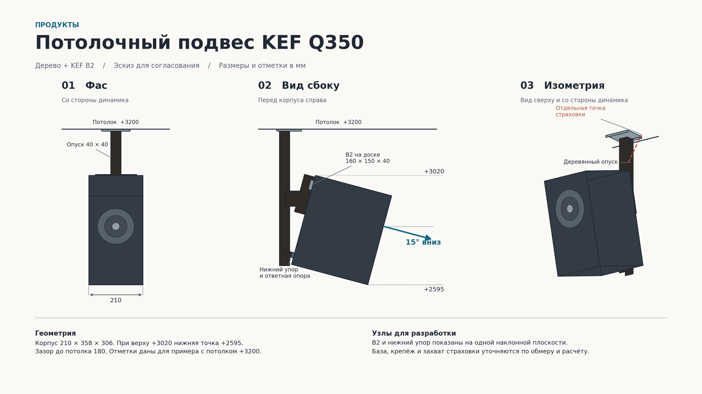

# Подвес KEF Q350: дерево + B2

**Статус:** концепт для согласования, не для производства.
**Дата:** 25.11.2026.
**Объект:** бар «Продукты», 9-я линия В.О., 60, лит. А.
**Репозиторий:** `p2p-audio-system-design`, папка `produkty/`.

Актуальная визуализация в проекте: [PNG](visuals/mount-wood-b2-3views.png) · [PDF](visuals/mount-wood-b2-3views.pdf).

## 1. Коротко

Для четырёх KEF Q350 предлагается не «люлька», а минимальный двухточечный узел:

- деревянная стойка **40×40** (дуб или ясень) от потолка до нижнего упора;
- верхняя доска **160×150×40**;
- стеновой кронштейн **KEF B2** на доске, в верхней части задней панели Q350;
- нижний упор и ответная опора в нижней части корпуса;
- верхняя база с анкерами в бетонный потолок;
- независимая страховка тросом **2 мм** в отдельную точку потолка;
- кабель **2×1,5** в штробе стойки, с сервисной петлёй.

Q350 висит **вертикально** (портрет), фронт смотрит **вниз на 15°**. Сверлить корпус не нужно: B2 крепится в штатные пилоты на задней панели.

**Чего в этом решении нет:** сложных шарниров, регулируемой вилки, охватывающей «клетки» и металлической люльки из первого эскиза. Первый эскиз отклонён как неготовый к производству.

## 2. Исходные ограничения

### 2.1. Объект

- Потолок — чёрная бетонная плита; по фото видны стальные фермы, воздуховоды, зелёный ГКЛВ, кирпич и чёрная плитка.
- **В точках крепления ферм нет** — крепимся в потолок/плиту. Это подтверждено пользователем по месту.
- Если в точке окажется **ГКЛВ**, а не бетон — **стоп**, крепление в ГКЛ не допускается.
- Сейчас этап закладных: электрика и трассы открыты, ферма не покрашена. Можно заложить площадки и кабельные трассы до чистовой отделки.
- Отметки потолка по проекту: зал +3,520 / +3,870; балки +2,560 / +2,520; навес над баром +2,400. Фактические отметки в четырёх точках надо замерить; в примере ниже принято **3,20 м**.
- При потолке **2,56 м** низ Q350 получается около **1,955 м** — для бара низко; такую точку надо пересматривать.

### 2.2. Пользовательские ограничения

- Крепление — в потолок, не в ферму (ферм в точках нет).
- Колонка — **вертикально**.
- Зазор от потолка — **15–20 см**.
- Наклон — **небольшой вниз**, 10–15°.
- **Максимально дёшево**.
- **Никаких сложных шарнирных конструкций.**
- Цвет/внешний вид — не главное; важнее работоспособность и цена.
- Готовый кронштейн **SMP25** оставить в смете как **запасной** вариант; дерево согласовать с архитекторами.

## 3. Принятая схема

### 3.1. Состав узла

| Поз. | Деталь | Размер / материал | Примечание |
|---|---|---|---|
| 1 | Потолочная база | плита и анкеры по расчёту | В бетон; в ГКЛВ нельзя |
| 2 | Стойка | 40×40, дуб/ясень | От потолка до нижнего упора; канал под кабель |
| 3 | Верхняя доска | 160×150×40 | Площадка под B2; соединение со стойкой в полдерева + клей + 2× M8 |
| 4 | KEF B2 | 39×148×28, 0,33 кг | В верхней части задней панели Q350; штатные пилоты |
| 5 | Q350 | 210×358×306, 7,6 кг | Вертикально, фронт вниз 15° |
| 6 | Нижний упор | ответная опора по месту | Не несёт вес; не даёт корпусу качаться и разворачиваться |
| 7 | Страховка | трос 2 мм | Независимая точка потолка, вокруг корпуса |
| 8 | Кабель | 2×1,5 | В штробе стойки, сервисная петля |

### 3.2. Почему доска 160×150, а не «перекрестие» 40×40

Площадка B2 — **148 мм** по высоте. На торце 40×40 она не держится: крепление попадает в край и в торец, нагрузка идёт на два самореза в МДФ. Поэтому верхняя деталь — **доска 160×150×40**, а не маленькое перекрестие.

Стойка 40×40 работает на сжатие и воспринимает боковые усилия; доска принимает B2 и передаёт нагрузку на стойку. Нижний упор разгружает B2 от качания и фиксирует низ корпуса.

### 3.3. Геометрия и высоты

При потолке **3200 мм** и зазоре **180 мм**:

| Параметр | Значение |
|---|---|
| Верх Q350 | 3020 мм |
| Низ Q350 (наклонённый габарит) | 2595 мм |
| Зазор до потолка | 180 мм |
| От потолка до низа | 605 мм |
| Доска | 150 мм |
| Q350 | 358 мм |

При потолке **2560 мм** низ Q350 — около **1955 мм**. Это низко для прохода и для бара; вариант допустим только после замера и согласования.

**Угол.** В концепте — **15°**. Пользователь просил 10–15°; акустически на расстоянии около 3 м лучше 20–25°, но это меняет фаску, низ колонки и нижний упор. Угол надо утвердить до производства.

### 3.4. KEF B2

- Официальная цена: **$99.99 за пару** (KEF US), EU — около **€49 за пару**.
- Размеры: **39×148×28 мм**, масса **0,33 кг**.
- B2 — **стеновой** кронштейн; для потолка отдельно не сертифицирован. В этой схеме он стоит на деревянной доске, а не на потолке; вся сборка дополнительно страхуется.
- Крепление к Q350 — в **штатные пилоты** на задней панели, без новых отверстий.
- B2 ставится в **верхней** части задней панели; нижний упор фиксирует низ. Это ближе к референсу: тонкая стойка, верхний узел, нижняя ответная опора.
- На 4 колонки нужно **2 пары**; в РФ ориентир **16–24 тыс. ₽**; наличие и цвет проверить.

### 3.5. Страховка и кабель

- Страховка — **трос 2 мм** вокруг корпуса Q350 в **отдельную** точку потолка, независимо от B2 и стойки.
- Трос не должен давить на гриль, порт и клеммы; на корпусе — мягкая прокладка.
- Кабель 2×1,5 идёт в штробе 8×8 по стойке, с разгрузкой и сервисной петлёй.
- Все кромки дерева и металла — без заусенцев; крепёж — с гроверами/фиксатором резьбы.

## 4. Альтернативы

| Вариант | Что это | Цена за 4 | Плюсы | Минусы |
|---|---|---|---|---|
| **Дерево + B2, B2 сверху + нижний упор** | Актуальная схема | **31–45 тыс. ₽** | Дёшево, ремонтопригодно, без сверления корпуса, близко к референсу | Дерево видимое; нужен столяр; согласование архитекторов; B2 не потолочный |
| **Дерево + B2, B2 снизу** | Вариант из обсуждения | 31–45 тыс. ₽ | Проще низ | B2 внизу даёт консоль и хуже соответствует референсу; отклонён |
| **Сталь + шпилька** | Плита + M12 + верхняя плита + клин 20° | **28–32 тыс. ₽** | Проще в расчёте, меньше дерева | Промышленный вид; сварка/покраска; жёсткий узел |
| **SMP25** | Готовый стеновой кронштейн | **22–26 тыс. ₽** | Серийный, 25 кг, вылет 269 мм, наклон ±10°, поворот ±45°, без сверления | Прямо в потолок не ставится; нужна стойка/плита; всё равно страховка; запасной вариант |
| **Старая «люлька»** | Охватывающая рама из первого эскиза | — | Формально держит | Нет узла крепления к корпусу, регулировки, страховки, допусков; отклонена |

### 4.1. SMP25 подробнее

- Комплект **2 шт**: **2 685 ₽** со скидкой (обычная 3 159 ₽); в Dr.Head — **3 990 ₽** за 2.
- Нагрузка до **25 кг** на кронштейн; вылет **269 мм**; наклон **±10°**; поворот **±45°**; вращение **±180°**.
- Ширина колонки **150–285 мм**; сталь **2 мм**; 5 лет гарантии; чёрный; кабель-канал.
- Q350 210×358×306, 7,6 кг — влезает, сверлить корпус не надо.
- Но SMP25 — **настенный**. Прямо в потолок его не поставить; нужна вертикальная стойка/плита. Как backup: 4 шт = 2 комплекта (5 370–7 980 ₽) + стойки/плиты/анкеры/страховка ≈ 16 тыс. ₽; итого **22–26 тыс. ₽**. В смету 24 тыс. ₽ почти влезает.

## 5. Цены и бюджет

### 5.1. Ориентиры

| Позиция | Цена | Источник/дата |
|---|---|---|
| KEF B2, пара | $99.99 / €49 | KEF US / EU, 25.11.2026 |
| B2, 2 пары в РФ | 16–24 тыс. ₽ | ориентир, наличие проверить |
| Дерево, стойка + доска | около 8 тыс. ₽ | столярка, ориентир |
| Металл, анкеры, болты | около 6 тыс. ₽ | ориентир |
| Нижний упор, страховка | около 4 тыс. ₽ | ориентир |
| Финиш, огнебиозащита | около 4 тыс. ₽ | ориентир |
| **Дерево + B2, 4 шт** | **31–45 тыс. ₽** | сумма ориентиров |
| SMP25 backup, 4 шт | 22–26 тыс. ₽ | Uniteki/Dr.Head |
| Сталь + шпилька, 4 шт | 28–32 тыс. ₽ | ориентир |
| KEF Q350, 2 пары | 78 000 ₽ | Аудиомания, 24.11.2026 |
| KEF Q150, 2 пары | 58 000 ₽ | Аудиомания, 24.11.2026 |
| KEF Kube 8 MIE | 56 000 ₽ | Dr.Head, 24.11.2026 |

Цены — розничные витрины, не КП. Наличие, скидки и сроки надо подтверждать.

### 5.2. Бюджет проекта

- В `preliminary-budget.csv` на четыре подвеса заложено **24 000 ₽** (4×6 000) плюс **12 000 ₽** на обмер и конструктив.
- База сметы — **385 933 ₽**; остаток от 400 000 ₽ — **14 067 ₽**.
- Дерево + B2 — **31–45 тыс. ₽**, то есть **+7–21 тыс. ₽** к строке 24 тыс. ₽.
- KEF Q150 + Kube 8 MIE при старом креплении 24 тыс. — **421 933 ₽**. С деревянным креплением 31–45 тыс. — ориентировочно **428 933–442 933 ₽**.
- Жёсткий лимит — **400 000 ₽**. Нужно решение: доплата, б/у саб, SMP25/сталь или сокращение других строк.

## 6. Что проверить на объекте

1. **Материал потолка** в каждой из четырёх точек: бетон или ГКЛВ. Если ГКЛВ — стоп.
2. **Отметка потолка** в каждой точке; 3,20 м принято условно.
3. **Фермы/балки/воздуховоды** рядом: не мешают ли стойке, тросу и кабелю.
4. **Штатные пилоты** на задней панели Q350: шаг и диаметр; B2 должен сесть без новых отверстий.
5. **Посадка B2** на доске 160×150: площадка 148 мм, крепёж не в краю.
6. **Нижний упор**: не давит на порт, клеммы и кабель; не мешает обслуживанию.
7. **Угол 15°**: не задевает ли низ колонки мебель/проход; не низко ли при 2,56 м.
8. **Страховка**: отдельная точка в бетоне, не в ГКЛВ; трос не давит порт/гриль.
9. **Кабель**: трасса, штроба, сервисная петля, разгрузка.
10. **Архитекторы**: внешний вид дерева, огнебиозащита, крепление, нагрузка.
11. **Прототип**: собрать один узел, повесить Q350, проверить наклон и отсутствие люфта; нагрузочный тест 5×.

## 7. Открытые вопросы

- **Угол:** 15° или 20°? 15° — по просьбе; 20–25° — лучше акустически.
- **Дерево:** дуб или ясень; натуральное или чёрное; лак/масло; огнебиозащита.
- **B2:** заказываем 2 пары? Какой цвет; срок.
- **Нижний упор:** конструкция и материал; как фиксирует низ, не царапая корпус.
- **SMP25:** оставляем в смете как backup или убираем?
- **Бюджет:** кто покрывает +7–21 тыс. ₽ на крепление и +21 933 ₽ на KEF?
- **Архитекторы:** согласуют ли видимое дерево и крепление?
- **Прототип:** кто изготовит и где испытываем?
- **Рабочий чертёж:** после подтверждения — три вида, размеры, допуски, крепёж, BOM, DXF.

## 8. Следующие шаги

1. Замерить четыре точки: материал, отметка, препятствия, доступ.
2. Купить/примерить B2 (2 пары) или один комплект.
3. Собрать прототип: стойка + доска + B2 + нижний упор + Q350; проверить 15° и зазор.
4. Нагрузочный тест 5×, проверка страховки.
5. Согласовать с архитекторами дерево, огнебиозащиту и вид.
6. Выпустить рабочий чертёж: три вида, размеры/допуски, крепёж, BOM, DXF.
7. Изготовить 4 комплекта, смонтировать, проверить наклон и кабель.
8. Обновить смету и README после утверждения.

## 9. История решений

- **24.11.2026** — первый эскиз: металлическая люлька с вилкой; отклонён как неготовый к производству.
- **24.11.2026** — предложен дешёвый вариант: плита + M12 + верхняя плита + клин 20°; 28–32 тыс. ₽.
- **25.11.2026** — пользователь предложил дерево + B2; SMP25 оставлен backup; согласование с архитекторами.
- **25.11.2026** — в первом варианте B2 стоял снизу; от него отказались в пользу B2 сверху + нижний упор: ближе к референсу и меньше консоль.
- **25.11.2026** — исправлен наклон: в первых трёх видах фронт смотрел вверх; теперь вниз 15°, добавлена стрелка «фронт вниз».

## 10. Файлы и ссылки

- [Три вида, PNG](visuals/mount-wood-b2-3views.png)
- [Три вида, PDF](visuals/mount-wood-b2-3views.pdf)
- [Сравнение АС и сабов](variants-400k.md)
- [Предварительная смета](preliminary-budget.csv)
- [KEF B2](https://us.kef.com/products/b2-wall-bracket)
- [KEF B2, монтажная инструкция](https://assets.kef.com/pdf_doc/B2WallBracket/B2-Installation-Guide.pdf)
- [KEF Q350](https://www.audiomania.ru/polochnaya_akustika/kef/kef_q350.html)
- [KEF Q350, паспорт](https://assets.kef.com/documents/qseries/q2017-product-manual.pdf)
- [SMP25](https://doctorhead.ru/product/uniteki_smp25_black/)
- [KEF Kube 8 MIE](https://doctorhead.ru/product/kef_kube_8_mie_black/)

---

**Граница ответственности.** Это концепт, а не рабочий чертёж. Анкеры, сечения, сварку, допуски, нагрузки и испытания назначает конструктор после обмеров. Монтаж — только после прототипа и проверки основания.
