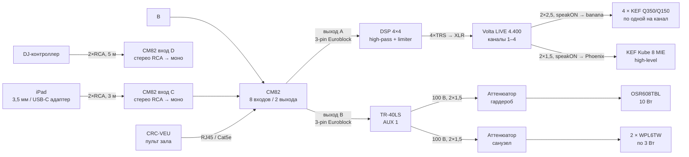

# «Продукты» · сетап, коммутация и схема подключения

**Сравнительный вариант.** Для текущей сметы и проверки на стенде используется [первичная схема от 26.11.2026](signal-flow.md) с отдельным линейным выходом DSP на саб. Маршрут high-level от канала 4 и его настройки относятся к варианту ниже.

Санкт-Петербург, 9-я линия В.О., 60, литера А. Рабочая редакция для согласования от 26.11.2026. Не для монтажа до подтверждения пунктов в конце.

## 1. Что принимаем за базу

- Три зоны: зал 02, гардероб 01, санузел 03/04/05.
- Один источник программы — iPad, плюс резервный стереовход DJ.
- Микшер Lab.gruppen CM82: 8 входов, 2 выхода A/B, моно-суммирование RCA, два RJ45-пульта.
- Зал: 4 × KEF Q350 или Q150 (решение по бюджету ниже), усилитель Volta LIVE 4.400, 4 независимых канала.
- Саб: KEF Kube 8 MIE, активный, 300 Вт, входы RCA и speaker-level. Ставим **high-level от канала 4 усилителя**, чтобы саб получил полный диапазон и не тянуть длинный RCA.
- Малые зоны: CM82 выход B → имеющийся CVGaudio TR-40LS → 100 В → два аттенюатора → OSR608TBL (гардероб, 10 Вт) и 2 × WPL6TW (санузел, по 3 Вт).
- Управление: CRC-VEU на выходе A CM82 (пульт зала), два 100-В аттенюатора (гардероб и санузел).
- Кронштейн Q350 в этот документ не входит: заказчик делает его отдельно.

## 2. Схема сигнала

## 3. Карта каналов и адресация

| Что | Куда | Примечание |
|---|---|---|
| iPad L/R | CM82 вход C, RCA | Стереопара суммируется в моно внутри CM82 |
| DJ L/R | CM82 вход D, RCA | Резервный вход; при длинном кабеле — балансный вариант |
| Служебный микрофон | CM82 вход A (5-pin) | Не используется; оставить свободным |
| Программа в малые зоны | CM82 вход C/D → выход B | Включить маршрутизацию B/C на A и B |
| Зал | CM82 выход A → DSP вход 1 | Общий регулятор зала — CRC-VEU на remote A |
| Малые зоны | CM82 выход B → TR-40LS AUX 1 | Уровень B выставить один раз, аттенюаторы — у персонала |
| DSP выход 1 | Volta канал 1 → Q350 З1 | High-pass 70 Гц, лимитер под Q350/Q150 |
| DSP выход 2 | Volta канал 2 → Q350 З2 | High-pass 70 Гц, лимитер |
| DSP выход 3 | Volta канал 3 → Q350 З3 | High-pass 70 Гц, лимитер |
| DSP выход 4 | Volta канал 4 → Q350 З4 + саб high-level | High-pass 40 Гц; саб получает полный диапазон |
| Гардероб | TR-40LS 100 В → аттенюатор → OSR | Отвод 10 Вт |
| Санузел | TR-40LS 100 В → аттенюатор → 2 × WPL | По 3 Вт, параллельно |

## 4. Узлы

### 4.1. iPad

- Выход: разъём 3,5 мм или USB-C → адаптер Apple с зарядкой.
- Кабель: 3,5 мм → 2 × RCA, экранированный, 3 м. Если iPad стоит дальше 3 м — USB-C аудиоинтерфейс или DI, не удлинять 3,5 мм.
- Вход CM82: B, RCA L/R. Внутри CM82 пара суммируется в моно.
- Настройка: громкость iPad 80 %, зарядка постоянно, автоблокировка выключена, уведомления выключены.
- Крепление: держатель на стойке/полке, кабель с разгрузкой, запас петлёй.

### 4.2. DJ

- Выход: RCA (бытовой контроллер) или балансный TRS/XLR (профи).
- Кабель: 2 × RCA, 5 м; при длине больше 5 м — 2 × TRS/XLR в 3-pin Euroblock, баланс.
- Вход CM82: C, RCA; при балансном варианте — C, 3-pin Euroblock.
- Настройка: уровень на контроллере 0 dB, gain на CM82 подстроить под iPad.
- Земля: не соединять экран RCA с корпусом с двух сторон; при фоне — DI/изолятор.

### 4.3. CM82

- Входы: C — iPad, D — DJ, B — резерв. A/E — микрофон/приоритет, не занимать.
- Выходы: A — зал, B — малые зоны.
- Выход A/B: 3-pin Euroblock, балансный, максимум +22 dBu (9,6 В).
- Питание: 230 В, IEC, 20 Вт, 1U, 44 × 437 × 248 мм, 2,4 кг.
- Маршрутизация: по умолчанию A–D идут на A, E–H на B. Для программы в обе зоны включить DIP-переключатели C/D/B на A + B (проверить по мануалу на месте). Если DIP не позволяет — продублировать источник на входы B и F через RCA-Y, но это худший вариант.
- Выход A: общий уровень выставить так, чтобы при максимуме CRC-VEU и номинальном сигнале не загорался Limit (+12 dBu); запас 6 дБ.
- Выход B: уровень выставить под TR-40LS, зафиксировать, закрыть крышкой/пломбой.
- Remote: RJ45 A — CRC-VEU; remote B — не используется, оставить заглушку.

### 4.4. CRC-VEU

- Пассивный аттенюатор, не аудиоустройство; включается в remote-порт CM82, а не в разрыв сигнала.
- Кабель: Cat5e/6, 8P8C, от CM82 до пульта зала; длина до 20 м, проверить.
- Пульт: в рабочей зоне персонала, подписан «ЗАЛ», доступен бармену, не гостям.
- Настройка: максимум — это максимум зала; минимум — не «ноль», а тихий фон. Проверить, что на минимуме саб не гудит и малые зоны не отключаются.
- Резервный remote B не подключать.

### 4.5. DSP 4×4

- Модель: the t.racks DSP 4x4 Mini (4 входа / 4 выхода, 6,3 мм TRS, limiter, EQ, delay; 119 € / ориентир 14 000 ₽, Thomann, 26.11.2026).
- Вход 1: CM82 выход A, 3-pin Euroblock → 6,3 мм TRS, баланс.
- Выходы 1–3: Volta 1–3, high-pass 70 Гц, лимитер под Q350/Q150.
- Выход 4: Volta 4, high-pass 40 Гц, лимитер; на этом канале висит Q350 З4 и саб high-level.
- Питание: 12 В адаптер, USB для настройки (Windows). После настройки — пресет, защита от изменений, USB отключить.
- Настройка limiter: Q350 — 125 Вт max, Q150 — 100 Вт max; порог по напряжению/мощности выставить с запасом 3 дБ; проверить розовым шумом.
- Если DSP не проходит по бюджету — вариант без него описан в разделе 9; он хуже по защите акустики.

### 4.6. Volta LIVE 4.400

- 4 канала класса D, 200 Вт на 8 Ом, 300 Вт на 4 Ом; входы 4 × XLR female, выходы 4 × speakON; 1,5U, 3,3 кг.
- Входы: DSP 1–4 → XLR 1–4; кабель TRS → XLR, баланс.
- Режим: STEREO, не BRIDGE/PARALLEL; каждый канал на свою Q350.
- Усиление: начать с −6 дБ, затем по SPL; не выкручивать в максимум.
- Выходы: speakON 1–4 → Q350; канал 4 дополнительно → саб high-level.
- Вентиляция: не закрывать, зазор 1U сверху/снизу, пыль.
- Питание: 230 В, IEC.

### 4.7. Q350 / Q150

- Одна колонка на канал, 8 Ом, без параллели.
- Кабель: 2 × 2,5 мм² OFC, speakON на усилителе, banana/spade на колонке; длина до 20 м; не в одной трубе с 230 В.
- Полярность: + / − строго; проверить батарейкой/тестером до подключения.
- Клеммы: затянуть, кабель с разгрузкой, сервисная петля; не вешать на провода.
- Q350: 358 × 210 × 306 мм, 7,6 кг, 8 Ом, мин. 3,7 Ом, 87 дБ, max 110 дБ, 15–125 Вт.
- Q150: 303 × 180 × 278 мм, 5,6 кг, 8 Ом, 86 дБ, max 108 дБ, 10–100 Вт.
- Грили KEF отдельно и сейчас не в наличии; открытые динамики в баре — риск, обсудить ткань/рамки.

### 4.8. Саб KEF Kube 8 MIE

- 8" (200 мм), 300 Вт RMS, 34–140 Гц, 293 × 293 × 310 мм, 9,4 кг; RCA/LFE + speaker-level.
- Сигнал: **high-level** с выхода Volta канал 4, параллельно Q350 З4; кабель 2 × 1,5 мм², speakON → Phoenix; полярность + / −.
- Не соединять минус выхода усилителя с землёй/корпусом: выход класса D может быть BTL. Если саб гудит/шумит — перейти на RCA от CM82 A с изолятором, но тогда нужен отдельный буфер/сплиттер.
- Настройка: low-pass 80 Гц, phase 0/180 по месту, gain 50 %, auto-on; проверить, что саб не отключается на тихом фоне.
- Питание: отдельная розетка 230 В, 3 × 2,5, УЗО; не из одного удлинителя с холодильником.
- Место: **на полу, предварительно слева от бара**, вне прохода; на плане — **оранжевый квадрат**: [placement-rack-sub.png](visuals/placement-rack-sub.png). Проверить бас у окон и стойки, дребезг мебели; место уточнить.

### 4.9. TR-40LS

- 40 Вт, 100 В / 4–16 Ом, 2 × AUX (2 × RCA), 1 × MIC TRS с приоритетом.
- Вход: CM82 выход B → AUX 1, 3-pin Euroblock → 2 × RCA; моно на оба RCA (или один RCA с согласованием уровня).
- AUX 2 и MIC не использовать; приоритет MIC выключить/не подключать.
- Выход: 100 В, клеммная колодка, 2 × 1,5 мм²; низкоомный выход не использовать одновременно.
- Настройка: master 50 %, EQ flat, суммарная нагрузка 16 Вт из 40 Вт; запас 2,5×.
- Питание: 230 В, 40 Вт.

### 4.10. Аттенюаторы 100 В

- Два независимых: гардероб (10 Вт) и санузел (6 Вт).
- Тип: 100-В автотрансформаторный, минимум 20 Вт на канал; 4 клеммы (IN +/−, OUT +/−) или 3 клеммы по схеме изготовителя.
- Кабель: 2 × 1,5 мм², полярность; не путать с 230 В.
- Место: гардероб — у входа/за стойкой, санузел — в тамбуре 03, доступ только персоналу; подписать «ГАРДЕРОБ» и «САНУЗЕЛ».
- Настройка: максимум — проектный уровень, минимум — тихо; зафиксировать ручку от случайного изменения.

### 4.11. OSR608TBL и WPL6TW

- OSR608TBL: 100 В, отвод 10 Вт, гардероб 2,74 м², настенная, IP65; кабель 2 × 1,5; полярность.
- WPL6TW: 100 В, отвод 3 Вт, кабинки 04/05, 2 шт параллельно; общий аттенюатор; кабель 2 × 1,5; полярность.
- В тамбуре 03 колонки нет.
- Проверить слышимость при закрытых дверях и уровень фона; при необходимости уменьшить отвод.

### 4.12. Питание

- Отдельная линия 230 В на рэк: 16 А, УЗО 30 мА, автомат; кабель 3 × 2,5, отдельная земля.
- Отдельная линия/розетка на саб: 16 А, УЗО; кабель 3 × 2,5; не общая с кухней/холодильником.
- Рэк: распределитель с защитой, нагрузка ~1,3 кВт; саб ~0,3 кВт; итого ~1,6 кВт.
- Последовательность включения: источники → CM82 → DSP → Volta → TR-40LS → саб; выключение в обратном порядке.
- Земля: одна точка, без «земляных петель»; аудиоэкраны не соединять с силовой землёй в двух местах.
- Проверить фазу/ноль, сопротивление заземления, УЗО кнопкой.

### 4.13. Рэк и место

- 19" рэк **Exegate 12U**, глубина 600, вентиляция, полка для DSP/TR-40LS, кабельные вводы, замок.
- Место: **левое верхнее помещение 06** (5,73 м²), **в углу**; на плане — **синий квадрат**; альтернатива — за баром, если есть доступ и вентиляция.
- CM82 1U, Volta 1,5U, DSP на полке, TR-40LS на полке, патч-панель/питание.
- План с рэком (синий) и сабом (оранжевый): [placement-rack-sub.png](visuals/placement-rack-sub.png).
- iPad — у бармена, не в рэке; зарядка.
- CRC-VEU — у бармена; кабель Cat5e в рэке.

### 4.14. Маркировка

- Входы CM82: C — IPAD, D — DJ, B — SPARE, A/E — MIC.
- Выходы: A — HALL, B — SMALL.
- Усилитель: CH1 — З1, CH2 — З2, CH3 — З3, CH4 — З4 + SUB.
- Кабели: A1 (iPad), A2 (DJ), A3 (CM82 A → DSP), A5 (CM82 B → TR), A6 (REMOTE A), S1–S4 (Q350), S5 (SUB), L1 (гардероб), L2 (OSR), L3 (санузел), L4/L5 (WPL), P1 (рэк), P2 (саб).
- Бирки — термоусадка/маркировка, с обеих сторон; схема в рэке.

## 5. Кабельный журнал

| ID | От | До | Сигнал | Кабель | Разъёмы | Длина* |
|---|---|---|---|---|---|---|
| A1 | iPad | CM82 C | стерео линейный | 2 × RCA, экран | 3,5 мм / 2 × RCA | 3 м |
| A2 | DJ | CM82 D | стерео линейный | 2 × RCA, экран | RCA / RCA | 5 м |
| A3 | CM82 A | DSP вход 1 | моно, баланс | 2 × 0,25, экран | 3-pin Euroblock → TRS 6,3 | 2 м |
| A5 | CM82 B | TR-40LS AUX 1 | моно, небаланс | 2 × 0,25, экран | 3-pin Euroblock → 2 × RCA | 2 м |
| A6 | CM82 remote A | CRC-VEU | управление | Cat5e/6 U/UTP | RJ45 / RJ45 | 15 м |
| D1–D4 | DSP 1–4 | Volta 1–4 | моно, баланс | 2 × 0,25, экран | TRS 6,3 → XLR | 1 м |
| S1–S4 | Volta 1–4 | Q350 З1–З4 | speaker | 2 × 2,5 OFC | speakON → banana | 15 м |
| S5 | Volta 4 | Kube high-level | speaker | 2 × 1,5 OFC | speakON → Phoenix | 8 м |
| L1 | TR-40LS 100 В | аттенюатор гардероб | 100 В | 2 × 1,5 | клеммы | 12 м |
| L2 | аттенюатор гардероб | OSR608TBL | 100 В | 2 × 1,5 | клеммы | 3 м |
| L3 | TR-40LS 100 В | аттенюатор санузел | 100 В | 2 × 1,5 | клеммы | 12 м |
| L4/L5 | аттенюатор санузел | WPL6TW 04/05 | 100 В | 2 × 1,5 | клеммы | 6 м |
| P1 | щит | рэк | 230 В | 3 × 2,5 | IEC/клеммы | 10 м |
| P2 | щит | саб | 230 В | 3 × 2,5 | Schuko/IEC | 10 м |

\* Длины предварительные, уточнить по месту. Кабель 80 м из закупки проверить по сечению: 4 × 15 м Q350 + 8 м саб + 100 В 33 м ≈ 101 м; 80 м может не хватить.

## 6. Уровни и настройка

1. iPad 80 %, DJ 0 dB; входы CM82 C/D подстроить так, чтобы при громком треке не загорался Clip.
2. CM82 выход A: при CRC-VEU в максимум и номинальном треке — зелёный Signal, без Limit; запас 6 дБ.
3. DSP: вход −6 дБ; выходы 1–3 high-pass 70 Гц, выход 4 high-pass 40 Гц; лимитер по Q350/Q150.
4. Volta: gain −6 дБ старт; поднять до нужного SPL, не до клипа.
5. Саб: low-pass 80 Гц, gain 50 %, phase 0/180 по месту; проверить на треке с басом.
6. CM82 выход B: уровень под TR-40LS; аттенюаторы в максимум; проверить баланс зал/гардероб/санузел.
7. Целевой SPL: фон 65–70 dBA, вечер 80–85 dBA; замер на 1 м от колонки/в точке гостя.
8. После настройки — пресет DSP, крышки/пломбы на уровнях, маркировка.

## 7. Проверка и приёмка

- Прозвонка и полярность всех линий; сопротивление Q350 ~8 Ом, 100-В линии — по отводам.
- Изоляция 100-В линий; отсутствие короткого на клеммах.
- Проверка каждой зоны отдельно: зал, гардероб, санузел; аттенюаторы в мин/макс.
- Проверка саба: фаза, отсутствие гула, отключение auto-on на тихом фоне.
- Проверка limiter: розовый шум, отсутствие клипа, нагрев.
- Проверка iPad и DJ: оба канала, моно-сумма, уровень, фон.
- Проверка CM82 remote: CRC-VEU плавно, без ступенек/шумов.
- Проверка питания: УЗО, земля, нагрев рэка, вентиляция.
- Маркировка, схема в рэке, инструкция бармену.

## 8. Смета: что меняется

База `preliminary-budget.csv`: 385 933 ₽ (Q350 78 000, люльки 24 000, конструктив 12 000, «линейное распределение/лимитер» 10 000, без саба). Добавляем iPad 25 000 ₽ (закупка) и 5 000 ₽ на согласование CM82/AUX — база для расчёта 415 933 ₽. Люльки и конструктив 36 000 ₽ убираем: заказчик делает крепление отдельно.

| Вариант | Q350/Q150 | Саб | DSP | iPad | Итого | 400 000 |
|---|---:|---:|---:|---:|---:|---:|
| Q150 + новый Kube + DSP 4×4 | 58 000 | 56 000 | 14 000 | 25 000 | 419 933 | +19 933 |
| Q150 + новый Kube, без DSP | 58 000 | 56 000 | 0 | 25 000 | 405 933 | +5 933 |
| Q350 + новый Kube + DSP 4×4 | 78 000 | 56 000 | 14 000 | 25 000 | 439 933 | +39 933 |
| Q350 + новый Kube, без DSP | 78 000 | 56 000 | 0 | 25 000 | 425 933 | +25 933 |
| Q150 + б/у Kube 39 000, без DSP | 58 000 | 39 000 | 0 | 25 000 | 388 933 | −11 067 |
| Q350 + б/у Kube 39 000 + DSP | 78 000 | 39 000 | 14 000 | 25 000 | 422 933 | +22 933 |

- Люльки и конструктив убираем: заказчик делает крепление отдельно.
- DSP 4×4 — **the t.racks DSP 4x4 Mini**: 4 входа/4 выхода 6,3 мм TRS, limiter/EQ/delay, USB/Windows, 160×150×40, 119 € / ~14 000 ₽, не рэковый. Альтернатива в `signal-flow` — **Behringer DCX2496LE** 28 864 ₽: 6 выходов, XLR, линейный саб; дороже на 14 864 ₽.
- Саб Kube 8 MIE: 56 000 ₽; б/у ориентир 35–45 000 ₽.
- Кабель саба/разъёмы: ~1 500 ₽, в резерве.
- Q150 — 29 000 ₽/пара; Q350 — 39 000 ₽/пара; цены Аудиомании на 24.11.2026, акция, наличие уточнить.
- **С iPad 25 000 ни один новый Kube в 400 000 не влезает.** Без DSP Q150 + новый Kube = 405 933 (+5 933); с DSP = 419 933 (+19 933). Влезает только Q150 + б/у Kube без DSP (388 933, −11 067) — риск б/у.

## 9. Если DSP не проходит по бюджету

Вариант без DSP: CM82 A → пассивный XLR-сплиттер на 4 входа Volta; саб high-level от канала 4; high-pass/limiter нет. Экономия 14 000 ₽, но Q150/Q350 не защищены от перегруза, а саб получает полный диапазон; у Volta нет настраиваемого DSP/кроссовера, только защита усилителя. Для бара с DJ это риск. Без DSP Q150 + новый Kube = 405 933 ₽, всё равно +5 933 к лимиту; без DSP бюджет не спасает.

## 10. Что нужно подтвердить

1. **Акустика**: оба варианта Q150 и Q350 оставляем рабочими; в жёсткий 400 000 с новым Kube и iPad 25 000 не проходит ни один без DSP; Q150 без DSP = 405 933 (+5 933), Q150 + б/у Kube без DSP = 388 933. Решение — за тобой.
2. **Рэк**: Exegate 12U, левое верхнее помещение 06, в углу; на плане — синий квадрат. Проверить 230 В, дверь и вентиляцию.
3. **DSP**: the t.racks DSP 4x4 Mini (14 000) или без DSP; **если без DSP** — 405 933 и нет HPF/лимитера. **DCX2496LE** — альтернатива 28 864, но дороже.
4. **Аттенюаторы**: модели/места в гардеробе и тамбуре санузла.
5. **Саб**: место, high-level или RCA; если high-level — проверить, что Kube не гудит от класса D.
6. **CM82 routing**: проверить DIP C/D/B на A+B по мануалу.
7. **Кабель**: сечение и остаток закупленных 80 м; хватает ли на 4 линии зала + 100 В + саб.
8. **Старый шлейф 5 точек**: оставляем/демонтируем; в новой схеме не используется.

## 11. Следующий шаг

После ответов на п. 1–3: обновить `preliminary-budget.csv` и `README.md`, выпустить схему подключения (PNG/PDF) и кабельный журнал с фактическими длинами, затем передать монтажнику.
