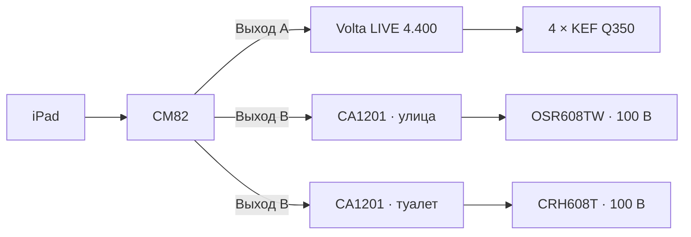

# Теплица · вариант A

iPad подаёт общую программу на Lab.gruppen CM82. Выход A обслуживает зал, выход B подаёт сигнал на два отдельных усилителя зон. У каждой зоны свой настенный регулятор CRC-V.

| Зона | Акустика | Усилитель | Управление громкостью |
|---|---|---|---|
| Зал | 4 × KEF Q350 Walnut | Volta LIVE 4.400 | CRC-V на выходе A CM82 |
| Улица | 1 × CVGaudio OSR608TW, 100 В, отвод 20 Вт | 1 × Lab.gruppen CA1201 | Отдельный CRC-V для этой зоны |
| Туалет | 1 × CVGaudio CRH608T, 100 В, отвод 8 Вт | 1 × Lab.gruppen CA1201 | Отдельный CRC-V для этой зоны |

## Перед монтажом

- Сверить режим 100 В, подключение CRC-V и назначение клемм по руководству CA1201. Каждый регулятор должен менять громкость только своей зоны.
- Подтвердить подключение KEF к Volta. При параллельном соединении пары минимум импеданса около 1,9 Ом. Предусмотреть проверку схемы с одной колонкой на канал.
- При пусконаладке проверить отводы колонок и задать предел громкости каждой зоны.

[Рабочая смета и статусы закупки](https://docs.google.com/spreadsheets/d/1uV0goTIWzc8BjLMTEEd3xBQX1XKyCQEsck7-6BgJBb0/edit#gid=1001).
