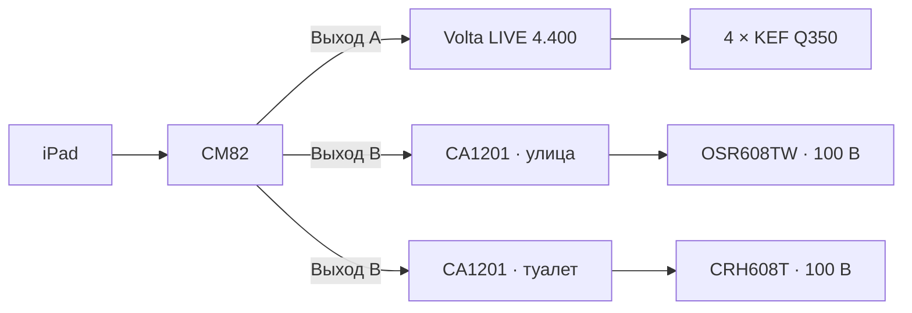

# Теплица · вариант A

iPad подаёт общую программу на Lab.gruppen CM82. Выход A обслуживает зал, выход B подаёт сигнал на два отдельных усилителя зон. У каждой зоны свой настенный регулятор CRC-V.

| Зона | Акустика | Усилитель | Управление громкостью |
|---|---|---|---|
| Зал | 4 × KEF Q350 Walnut | Volta LIVE 4.400 | CRC-V на выходе A CM82 |
| Улица | 1 × CVGaudio OSR608TW, 100 В, отвод 20 Вт | 1 × Lab.gruppen CA1201 | Отдельный CRC-V для этой зоны |
| Туалет | 1 × CVGaudio CRH608T, 100 В, отвод 8 Вт | 1 × Lab.gruppen CA1201 | Отдельный CRC-V для этой зоны |

## Перед монтажом

- Сверить режим 100 В, подключение CRC-V и назначение клемм по руководству CA1201. Каждый регулятор должен менять громкость только своей зоны.
- Подтвердить подключение KEF к Volta. При параллельном соединении пары минимум импеданса около 1,9 Ом. Предусмотреть проверку схемы с одной колонкой на канал.
- При пусконаладке проверить отводы колонок и задать предел громкости каждой зоны.

[Рабочая смета и статусы закупки](https://docs.google.com/spreadsheets/d/1uV0goTIWzc8BjLMTEEd3xBQX1XKyCQEsck7-6BgJBb0/edit#gid=1001).

## Зал и размещение KEF

Номинальный импеданс Q350 — 8 Ом. Две одинаковые колонки параллельно дают номинальные 4 Ом. Импеданс меняется с частотой: при минимуме 3,7 Ом у одной колонки пара опускается примерно до 1,85 Ом. Для четырёх колонок предлагаем четыре отдельных канала Volta, по одной Q350 на канал. Распределение линейного сигнала на четыре входа и назначение контактов speakON проверить по конкретному усилителю.

[Руководство KEF Q Series для Q350 (PDF)](../manuals/KEF-Q-Series.pdf) · [Источник файла — Аудиомания](https://img.audiomania.ru/data/kef_q350.pdf).

**Крепление KEF — решение отложено.** Уточнить, делают ли четыре полки. Решение о закупке кронштейнов принять после подтверждения полок. Строка кронштейна в рабочей смете относится к iPad.

## Улица и туалет: разводка выхода B

Предлагаем распределить один балансный линейный выход B на два линейных входа CA1201 параллельно. Штатные зелёные разъёмы Euroblock есть. Если выходной разъём допускает по два проводника на контакт, вывести две короткие ветви прямо от него. Иначе вывести одну линию на три изолированные распределительные клеммы в шкафу и оттуда — две ветви. На обоих усилителях сохранить полярность + и − и подключение экрана по маркировке производителя. До сборки сверить назначение контактов и допустимую нагрузку выхода B при двух входах в параллель.

CRC-V улицы подключить к управлению первого CA1201, CRC-V туалета — второго. Каждому усилителю соответствует своя отдельная акустическая линия 100 В. Громкость выхода B на CM82 задаёт общий уровень обеих зон.

Шкаф согласован, по регуляторам, трассам и источнику дополнительных вопросов у команды нет.
